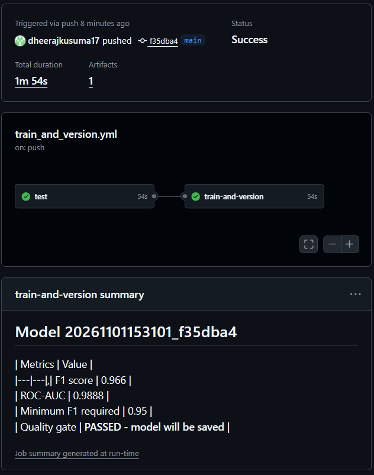
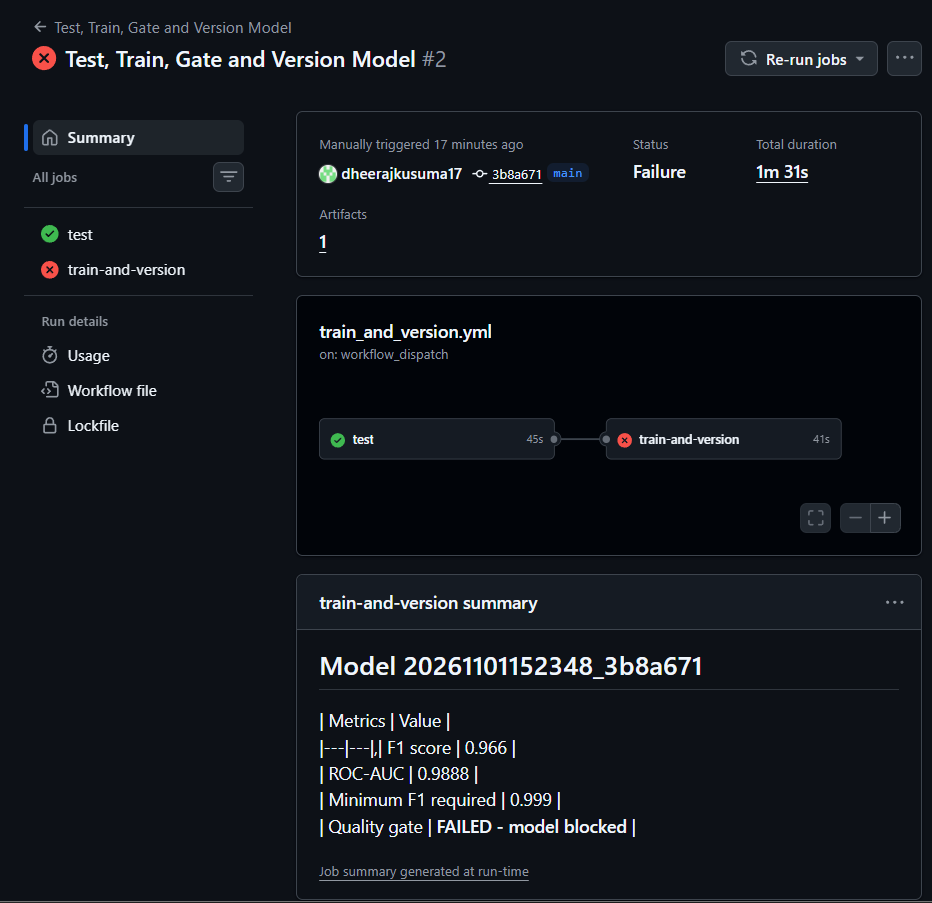

# GitHub Actions Lab 2 (Modified): Test, Train, Gate and Version an ML Model

A modified version of `Labs/Github_Labs/Lab2` from the Northeastern MLOps course
([raminmohammadi/MLOps](https://github.com/raminmohammadi/MLOps)).

Every time ML code changes, **GitHub Actions** (a robot that runs on GitHub's computers) automatically:

1. runs the tests,
2. trains a new model,
3. checks the model is good enough (a **quality gate**),
4. saves the model, its scores and its MLflow log as downloadable files,
5. commits the new model version back into this repo, **only if it passed the gate**.

## What I changed from the original lab

### The CI/CD pipeline (the lab's core concept)

| Area | Original | My version |
|---|---|---|
| Workflow files | 2 near-duplicate files (`model_calibration.yml`, `model_calibration_on_push.yml`) | 1 file: `.github/workflows/train_and_version.yml` |
| Triggers | Push to main **or** daily schedule (separate files) | Push to main **with path filters** (README edits don't retrain), a **manual "Run workflow" button with an input box**, and a weekly schedule |
| Jobs | 1 job doing everything | **2 jobs**: `test` runs first; `train-and-version` only starts if tests pass (`needs: test`) |
| Tests | `test/` folder was empty; no tests ran | 4 pytest tests run on every pipeline run |
| Quality gate | None. Any model was committed, however bad | Evaluation fails the run if F1 is below a minimum (default 0.95), so weak models are **blocked** |
| Results | Only committed files | **Artifacts** (model, metrics, MLflow log) downloadable from each run, even failed ones, plus a **results table on the run page** |
| Versioning | Timestamp only | Timestamp + commit ID, e.g. `20261031120000_ab12cd3`, so every model links to the exact code that made it |
| Speed | Packages downloaded on every run | **pip caching** reuses packages between runs |
| Safety | No push permissions set; runs could clash; the robot's own commit could retrigger | `permissions: contents: write`, a `concurrency` lock, and `[skip ci]` on the robot's commits |
| Actions versions | `checkout@v2`, `setup-python@v2`, Python 3.9 | `checkout@v4`, `setup-python@v5`, `upload-artifact@v4`, Python 3.11 |
| Paths | Hard-coded to the course repo (`Labs/Github_Labs/Lab2/...`) | Work from this repo's root |

### Dataset and model

| Area | Original | My version |
|---|---|---|
| Dataset | Random synthetic data with a **random number of rows (could be 0, which crashes)**, mislabelled as "Reuters Corpus" | **Breast Cancer Wisconsin**: 569 real tumour samples, 30 measurements each (0 = malignant, 1 = benign) |
| Model | Random Forest | **Gradient Boosting** (150 trees, learning rate 0.1, depth 3) |
| Evaluation | Scored on data the model had already seen, or on different random data | Proper **80/20 train/test split**; scored only on the 20% the model never saw |
| Metrics | F1 only | F1, accuracy and ROC-AUC, plus pass/fail and the gate threshold |
| MLflow | Created a new experiment on every run | One experiment; each run is named after the model version |

## Project structure

```
.github/workflows/train_and_version.yml   <- the CI/CD pipeline
src/train_model.py                        <- step 1: train and save a versioned model
src/evaluate_model.py                     <- step 2: score the model + quality gate
test/test_pipeline.py                     <- automated tests, run before training
models/                                   <- versioned models saved by the pipeline
metrics/                                  <- metrics JSON for each saved model
requirements.txt                          <- Python packages
```

## What you need

**To run the pipeline on GitHub (main way):**
1. A free **GitHub account**: https://github.com
2. **Git**: https://git-scm.com/downloads (check with `git --version`)

Nothing else is needed. GitHub installs Python 3.11 and all packages on its own computers.

**Optional, to run it on your own computer:** Python 3.11 (https://www.python.org/downloads/).
On Windows, tick **"Add python.exe to PATH"** during install.

## How to run it on GitHub

1. **Fork** this repo (the **Fork** button at the top right).
2. Make sure Actions can save files back to the repo:
   **Settings → Actions → General → Workflow permissions → "Read and write permissions" → Save**.
3. Start the pipeline in either of these ways:
   - **Button:** **Actions** tab → **Test, Train, Gate and Version Model** (left side) → **Run workflow** → **Run workflow**.
   - **Push:** change any file in `src/` or `test/`, then commit and push.
4. Watch it run in the **Actions** tab. It takes about 2 to 4 minutes.

### What a successful run looks like

- Both jobs show a green tick: **test ✅ → train-and-version ✅**
- The `test` job log ends with `4 passed`.
- The run's summary page shows a table like this:

  | Metric | Value |
  |---|---|
  | F1 score | 0.966 |
  | Accuracy | 0.9561 |
  | ROC-AUC | 0.9888 |
  | Minimum F1 required | 0.95 |
  | Quality gate | **PASSED - model will be saved** |

- At the bottom of the summary page, under **Artifacts**, there's a downloadable `model-<version>` file.
- A new commit from `github-actions[bot]` appears in the repo, adding `models/model_<version>.joblib`
  and `metrics/metrics_<version>.json`.

### See the quality gate block a model

1. **Actions** tab → **Run workflow**.
2. Type `0.999` in the **Minimum F1 score** box → **Run workflow**.
3. Expected result:
   - `train-and-version` shows a **red X** at the "Evaluate the model (quality gate)" step.
   - The log says `QUALITY GATE FAILED: F1 0.966 is below 0.999`.
   - The summary table says **FAILED - model blocked**.
   - The artifacts are still uploaded so you can inspect them, but **no new model is committed**.

## Screenshots

**Successful run:** tests pass, the model passes the gate, and the new version is saved.



**Quality gate blocking a model** (minimum F1 set to 0.999):



## Optional: run it on your own computer

Windows (PowerShell), from inside the project folder:
```
git clone https://github.com/dheerajkusuma17/gh-actions-lab.git
cd gh-actions-lab
python -m venv venv
venv\Scripts\activate
python -m pip install -r requirements.txt
python -m pytest -v
python src/train_model.py --version local1
python src/evaluate_model.py --version local1 --min-f1 0.95
```
macOS/Linux: same, but activate with `source venv/bin/activate`.

If PowerShell says "running scripts is disabled", run
`Set-ExecutionPolicy -Scope CurrentUser RemoteSigned`, type `Y`, then activate again.

**Expected output:**
- `pytest` ends with `4 passed`.
- Training prints `Model saved to: models/model_local1.joblib`.
- Evaluation prints the metrics and ends with `QUALITY GATE PASSED`.

## Troubleshooting

| Problem | Fix |
|---|---|
| Last step fails with `Permission denied` or `403` | Turn on **Read and write permissions** (step 2 above), then run again |
| No **Run workflow** button | The workflow file must be at `.github/workflows/train_and_version.yml` on the `main` branch |
| Pushed but nothing ran | Only changes in `src/`, `test/`, `requirements.txt` or the workflow file start a run. Use the button instead |
| `git` is not recognized | Install Git, then close and reopen your terminal |
